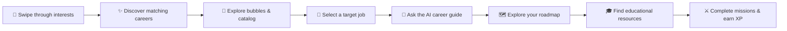

<div align="center">

# 🎻 Orquest

### Your Future Is a Quest. Level Up Your Career.

**🦈 SharkByte Hackathon 2026 · Miami Dade College**

Discover what interests you. Find a job worth pursuing. Turn your next step into a quest.


**[🎮 Demo access](#deployment) · [💻 GitHub](https://github.com/Oliver102274/Orquest) · [🚀 Run locally](#local-development) · [📋 Release checklist](docs/FINAL_SHARKBYTE_RELEASE.md)**

**20 job families · 115 occupations · One job-first adventure**

</div>

---

## 🧭 What is Orquest?

Choosing a major is easier when you can picture the job on the other side. **Orquest starts with the job.** It turns career exploration into an interactive, RPG-inspired experience: discover your interests, explore occupations, ask an AI career guide questions, investigate educational pathways, and complete missions toward your next step.

No account or password is needed. Enter as a guest and explore.

## 🗺️ How it works



**Discover → Match → Explore → Choose → Ask → Plan → Learn → Level up**

## ⚔️ What's in your quest inventory?

| Feature | What you can do |
| --- | --- |
| 🎴 **Interactive discovery** | Answer eight adaptive main questions with swipe interactions and optional follow-ups. Interest matching uses bundled research and is labeled accordingly—not a scientific prediction. |
| 🫧 **Bubble Explorer** | Search **20 job families and 115 occupations**, investigate specific jobs, and explicitly choose your target. A labeled catalog snapshot supports browsing when the API is unavailable. |
| 💬 **Career conversations** | Ask Gemini about your selected career. When AI is unavailable, validated catalog guidance answers salary, education, skills, outlook, getting-started, and resource questions where information exists. |
| 🎓 **MDC & beyond** | Investigate verified career-linked Miami Dade College resources, external learning resources, and **247 MDC catalog program records**. The Cybersecurity Associate in Science demo includes its official source and **60 credits**. |
| 🗺️ **Personalized roadmaps** | Work backward from a target job using available qualifications, verified resources, and optional, consented profile answers. Explore alternatives rather than assuming every occupation requires one degree. |
| ⚔️ **Missions & XP** | Open activities in the RPG constellation, complete them in the real world, then report completion. The backend calculates XP and prevents duplicate rewards for the same mission. |
| 💾 **Guest save & import** | Export selected career paths and consented questionnaire context. Import supported saves, including older card-based sessions, without creating an account. |

> **Temporary progress, clearly labeled.** XP and mission sessions live in server memory. Browser refresh, server restart, or session expiry can lose access. Save files do **not** preserve XP, session tokens, chat history, or the new discovery answers/matches. Guest progress is not stored permanently in a cloud account.

The original **12-card API and deterministic matching rules** remain available and support older saves. New discovery sessions do not invent legacy card answers. Career and occupation IDs remain stable.

## 🛠️ Technology stack

| Layer | Implemented tools |
| --- | --- |
| Experience | React, Vite, retro/pixel styling and interactive career maps |
| Backend | Python 3.11, FastAPI, Pydantic, Uvicorn |
| AI guidance | Google Gemini through the official Google Gen AI SDK, with structured response validation and deterministic fallback |
| Data | Contributor JSON catalogs, source metadata, verified educational resources and explicit occupation mappings |
| Quality | pytest, Vitest, React Testing Library and real-backend UI smoke tests |
| Delivery | Docker, Render Free, GitHub branches and pull requests |

**Optional sponsor tooling:** Swarms multi-agent workflows and Prune gateway/receipt tooling were independently tested by the team. Their integrations are **disabled by default** and are not used by public career conversations. OpenRouter supports explicitly free model variants with zero-price routing safeguards; it is also excluded from public routing. See [sponsor implementation notes](docs/SPONSOR_INTEGRATIONS.md).

## 🛡️ AI and safety

- **Gemini is the public AI integration.** Responses carry **AI-GENERATED DRAFT / REVIEW REQUIRED** labels. Provider failures and exhausted budgets fall back to catalog guidance; safety refusals remain blocked.
- **Sources, not invented promises.** Available references accompany guidance. Generated links must come from supplied verified evidence. Missing information is disclosed; no admission, salary, employment, or qualification outcome is guaranteed.
- **Keep evidence in context.** Catalog salary figures are national U.S. reference data, **not Florida or Miami salaries**. Contributor rows retain their unverified status. MDC SOC matches and keyword suggestions are candidates, not automatically verified or required qualifications.
- **Keys stay on the backend.** Never put provider secrets in frontend code, Git, or `VITE_*` variables. Public AI requires explicit opt-in, an unbilled Free Tier project, and bounded request limits. There are no automatic retries or paid-provider fallbacks; in-memory limits alone do not guarantee no billing.

Explore safely with no AI key or database. [Public Gemini configuration](docs/PUBLIC_GEMINI_DEMO.md) documents the existing production safeguards.

<a id="local-development"></a>
## 🚀 Local development

**Prerequisites:** Git, Conda and Node.js 22. Run these PowerShell commands from the repository root unless noted.

```powershell
git clone https://github.com/Oliver102274/Orquest.git
cd Orquest
conda env create -f environment.yml
npm --prefix frontend ci
```

Already have the `orquestra` environment? Skip creation and update its dependencies with `conda run -n orquestra python -m pip install -r backend/requirements.txt`. Conda is for the Python backend only.

**Terminal 1 — backend, with AI off and the MDC demo on:**

```powershell
$env:ORQUESTRA_AI_ENABLED="false"
$env:PUBLIC_AI_ENABLED="false"
$env:ORQUESTRA_MDC_DEMO_ENABLED="true"
conda run --no-capture-output -n orquestra python -m uvicorn backend.main:app --host 127.0.0.1 --port 8000
```

**Terminal 2 — frontend:**

```powershell
npm --prefix frontend run dev -- --port 5174
```

Open **http://localhost:5174**. Local API docs: **http://localhost:8000/docs**. No provider keys, paid services, or database are required.

Development API requests default to `http://localhost:8000`; trusted origins include ports 5173 and 5174. Production uses the same HTTPS origin unless `VITE_API_BASE_URL` explicitly overrides it at build time. The normal app reads process environment variables and does not silently load private `.env` files.

<details>
<summary><strong>🧪 Tests and API reference</strong></summary>

Validated application release: **165 backend tests + 45 subtests**, **91 frontend unit tests + 4 real-backend UI flows**, and a successful Vite production build. These are the application release results, not newly rerun tests for this README-only update.

```powershell
conda run -n orquestra python -m pip install pytest
conda run -n orquestra python -m pytest tests -q
npm --prefix frontend test
npm --prefix frontend run build
conda run --no-capture-output -n orquestra python tests/manual_frontend_integration.py --worktree . --mdc-demo --production
```

The integration runner starts and stops a loopback server, disables AI before application creation, and checks React flows, API contracts and production route refreshes. It makes no AI or database calls.

| Area | Endpoints |
| --- | --- |
| Matching | `GET /api/cards`, `POST /api/matches` |
| Careers & catalog | `GET /api/careers/{id}`, `GET /api/job-families`, `GET /api/occupations`, `GET /api/occupations/{id}`, `GET /api/occupation-mappings` |
| Resources & guidance | `GET /api/occupations/{id}/resources`, `POST /api/career-questions`, `POST /api/roadmaps`, `POST /api/occupations/{id}/roadmap` |
| Progress & health | `POST /api/progress`, `GET /api/progress/{id}`, `PUT /api/progress/{id}/missions/{mission_id}/completion`, `GET /api/health` |

</details>

<a id="deployment"></a>
## 🌐 Deployment & demo access

The existing **`orquest-demo` Render Free service** runs a Docker build that serves React and FastAPI from one HTTPS origin. **The public URL and deployment of the final release have not been confirmed from Render settings for this documentation update.** A direct Live Demo link is intentionally withheld until that verification; you can run the complete guest experience locally above.

The validated application is integration commit **`3c9e0db`**, included in `main` through **[`118bd11` / PR #8](https://github.com/Oliver102274/Orquest/pull/8)**. A documentation merge does not mean that application version has been deployed.

<details>
<summary><strong>🐳 Docker and existing Render service instructions</strong></summary>

```powershell
docker build -t orquest .
docker run --rm -p 10000:10000 -e ORQUESTRA_MDC_DEMO_ENABLED=true orquest
```

The multi-stage Dockerfile builds Vite assets, copies all `data/` files—including MDC catalogs and demo pathways—and runs FastAPI as a non-root user with one worker. `.dockerignore` excludes secrets and local worktrees. No credentials are needed for this deterministic demo. Docker was unavailable on the validation workstation; equivalent production serving and built assets were smoke-tested locally, but a container build is not claimed.

For the existing Render service, preserve the **Free** plan, root directory unset, Docker context `.`, `./Dockerfile`, and current startup command. The tracked Blueprint selects `codex/phase10-integration` with auto-deploy off. Confirm the actual dashboard branch before deployment.

Use **Manual Deploy → Deploy a specific commit** for validated application SHA `3c9e0db8bc94a16e0e5d68a14d25cfe0e65a3ed6`. **Do not resynchronize the Blueprint or overwrite working Gemini secrets/settings.** No new service or database is required. Verify the deployed SHA and public HTTPS URL in Render before adding the demo link to a submission.

[Deployment guide](docs/RENDER_FREE_DEPLOYMENT.md) · [Final release checklist](docs/FINAL_SHARKBYTE_RELEASE.md)

</details>

## 🤝 The party behind Orquest

| Contributor | Contribution |
| --- | --- |
| **Oliver Hernandez** | Project lead, backend, AI orchestration, safety and final integration |
| **Gzapple / eclimind** | React UI/UX, adaptive discovery, Bubble Explorer, chat and RPG experience |
| **Daniel Espinosa** | Career research, MDC pathways, official-source catalog and resource discovery |
| **henryadepeko-hub** | Swipe content, occupation catalog, external learning resources and documentation |

Names and handles follow repository documentation and Git history. Teammates' README and Devpost drafts remain preserved. See the [team workflow](docs/TEAM_WORKFLOW.md) and [API contract draft](docs/API_CONTRACT_DRAFT.md); draft contracts remain subject to team approval.

## 🦈 Built for SharkByte

Orquest tackles the **career and education pathway challenge** at **SharkByte Hackathon 2026**: help students connect an interesting job to practical learning opportunities at Miami Dade College and beyond.

Gemini powers the career-guidance integration. Swarms and Prune have separately demonstrated sponsor tooling; neither is advertised as powering the public conversation flow. OpenRouter remains optional free-model tooling. No award or sponsor-challenge win is claimed.

## 🔮 The next quests

Future work—not current features: optional accounts, persistent cloud progress, more educational institutions, and expanded, independently verified career data.

---

<div align="center">

**Every career starts with a quest. Ready to begin yours?**

🎴 Discover your interests. 🎯 Choose your direction. ⚔️ Take the next step.

</div>
